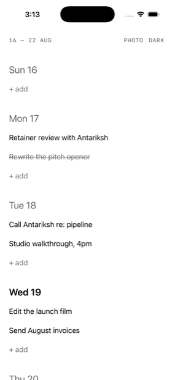
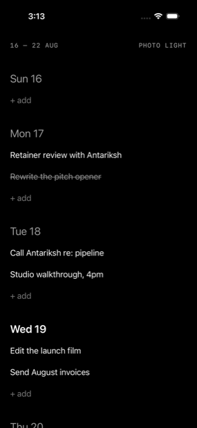
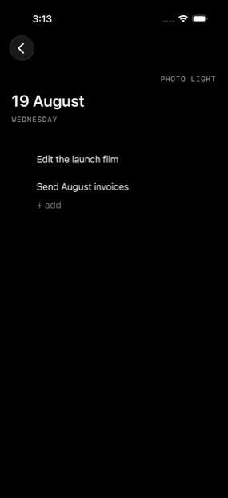
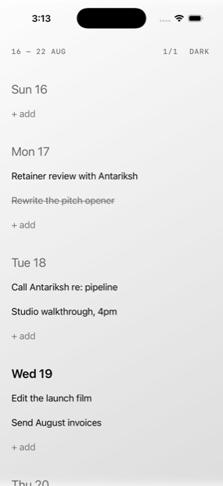

<div align="center">

# Slate

**A weekly planner for people who don't want a productivity system.**

One week. One tap to capture. Nothing leaves your phone.

  

</div>

---

## What it is

Slate opens straight to this week — seven days, in order, nothing else. Tap `+ add` under any day and start typing; press return and the field stays open for the next one. That's the whole interaction model.

There are no projects, tags, priorities, due times, reminders, streaks, or dashboards. There is no account to make, nothing to sync, and no network code in the binary at all. Plans older than 30 days delete themselves quietly, so the app never becomes an archive you feel guilty about.

It is deliberately a **bounded planning surface**, not a task manager.

## What it does

| | |
|---|---|
| **See the week** | Seven locale-aware days. Today is bolder — no badge, no pill, no accent colour. |
| **Capture without ceremony** | `+ add` becomes a focused field in place. Return saves and keeps typing. Tapping away commits what you wrote. |
| **Focus a day** | Tap a date to push into it. Full task text, inline editing, native back. |
| **Move between weeks** | Swipe sideways, or tap the week range for a compact 17-week picker. |
| **Complete and delete** | Tap to complete — strikethrough, no green tick. Swipe for a plain `Delete`. |
| **Two switches, no settings screen** | `PHOTO` cycles up to three wallpapers. `LIGHT`/`DARK` flips the appearance. That's every preference there is. |

## Wallpaper, quietly

Pick a photo and Slate strips its metadata, desaturates it, blurs it, and drops it to a third opacity under a scrim — so it reads as *ground*, never as content, and your tasks never lose contrast.

<div align="center">

</div>

The photo picker runs out of process, so Slate never asks for access to your photo library — and never gets it.

## Privacy is structural, not promised

The interesting part isn't a policy page, it's the absence of code:

- **No network layer.** No `URLSession`, no web view, no sockets, no analytics, no crash reporter, no third-party SDKs. A [build script](Scripts/verify-release-constraints.sh) fails the release archive if any of that ever appears.
- **No cloud.** No CloudKit, no iCloud container, no entitlements file at all.
- **No permission prompts.** Not one, anywhere in the app.
- **Nothing to collect.** The privacy manifest declares no collected data, because there is none.

Your tasks live in one local database that's excluded from device backup. If you delete the app, they're gone — that's the trade for nothing ever leaving the phone.

## Built with

Swift 6 · SwiftUI · SwiftData · Apple frameworks only — **zero third-party dependencies**, in a **~620 KB** app.

| | |
|---|---|
| Minimum iOS | 17.0 |
| Tests | 112 unit + 32 UI, all passing |
| Accessibility | VoiceOver actions, Dynamic Type to accessibility XXXL, Increase Contrast, Reduce Motion, RTL, 44pt targets |

Everything is native on purpose: system swipe actions, the system keyboard, real haptics, semantic colours that invert exactly between light and dark, and San Francisco at three type levels — date, task, metadata. Nothing is reimplemented that iOS already does well.

## Build it

Requires Xcode 26 and an iOS simulator, or an iPhone on iOS 17+.

```bash
git clone https://github.com/garvitkhandelwal/Slate.git
```

```bash
open Slate/Slate.xcodeproj
```

Select your team under **Signing & Capabilities** (needed for a device; the simulator works without one), then press **⌘R**.

Run the full suite with:

```bash
xcodebuild -project Slate.xcodeproj -scheme Slate -destination 'platform=iOS Simulator,name=iPhone 17' test
```

## Repository

| Path | |
|---|---|
| [`Slate/`](Slate) | The app — `App`, `Domain`, `Data`, `Services`, `Features`, `DesignSystem`, `Resources` |
| [`SlateTests/`](SlateTests) · [`SlateUITests/`](SlateUITests) | Unit, integration, UI, accessibility, and performance tests |
| [`Scripts/`](Scripts) | The static privacy and release audit, run before every archive |

## Status

v1 is implementation-complete and runs on device. Add your own signing team to build it on hardware.

<div align="center">
<sub>Made for one week at a time.</sub>
</div>
