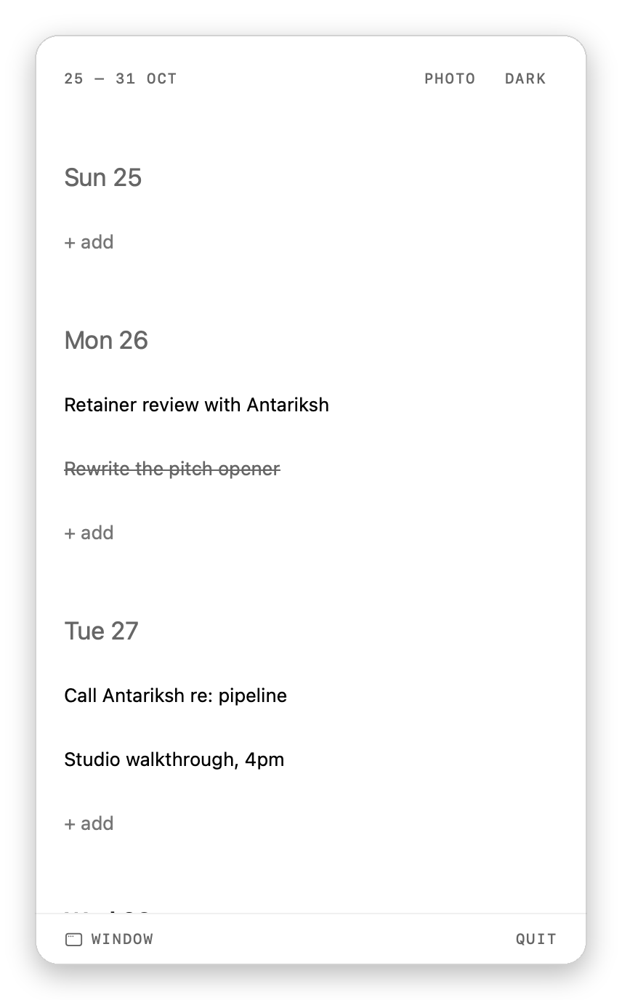
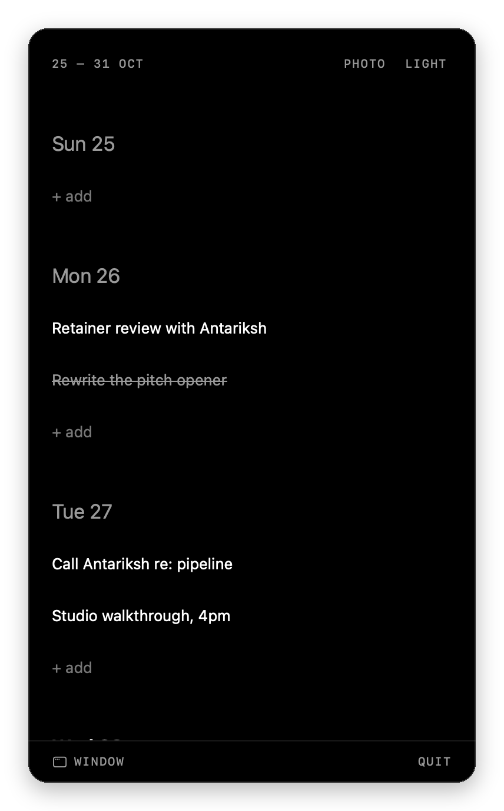

<div align="center">

# Slate

**A weekly planner for people who don't want a productivity system.**

One week. One tap to capture. Nothing leaves your device. On iPhone, and in your Mac's menu bar.

  

</div>

---

## What it is

Slate opens straight to this week — seven days, in order, nothing else. Tap `+ add` under any day and start typing; press return and the field stays open for the next one. That's the whole interaction model.

There are no projects, tags, priorities, due times, reminders, streaks, or dashboards. There is no account to make, nothing to sync, and no network code in the binary at all. Plans older than 30 days delete themselves quietly, so the app never becomes an archive you feel guilty about.

It is deliberately a **bounded planning surface**, not a task manager.

## What it does

| | |
|---|---|
| **See the week** | Seven locale-aware days. Today is bolder — no badge, no pill, no accent colour. |
| **Capture without ceremony** | `+ add` becomes a focused field in place. Return saves and keeps typing. Tapping away commits what you wrote. |
| **Focus a day** | Tap a date to push into it. Full task text, inline editing, native back. |
| **Move between weeks** | Swipe sideways, or tap the week range for a compact 17-week picker. |
| **Complete and delete** | Tap to complete — strikethrough, no green tick. Swipe for a plain `Delete`. |
| **Two switches, no settings screen** | `PHOTO` cycles up to three wallpapers. `LIGHT`/`DARK` flips the appearance. That's every preference there is. |

## On the Mac, in the menu bar

<div align="center">
 
</div>

Slate for macOS lives in the menu bar. Click the small slate glyph and the same planner drops down: the same week, the same `+ add`, the same `PHOTO` and `LIGHT`/`DARK` switches, at phone width. There's no Dock icon and no window until you want one.

`WINDOW` at the foot of the panel, or opening Slate from Finder, pops the planner out into an ordinary window. While that window is open Slate behaves like any Mac app, with a Dock icon, ⌘-Tab, and menus. Close it and Slate goes back to the menu bar. Right-click a task to complete or delete it, right-click empty ground for wallpaper options, and press ⌘[ to go back from a day.

The Mac app runs in the App Sandbox with **no network entitlement at all**, and it can read only the one image you pick as a wallpaper.

> On a MacBook with a notch, a crowded menu bar can hide new items behind the notch. If you don't see the slate glyph after launching, hold ⌘ and drag it into view, or make room by removing an item you don't use.

## Wallpaper, quietly

Pick a photo and Slate strips its metadata, desaturates it, blurs it, and drops it to a third opacity under a scrim — so it reads as *ground*, never as content, and your tasks never lose contrast.

<div align="center">

</div>

The photo picker runs out of process, so Slate never asks for access to your photo library — and never gets it. On the Mac the standard open panel does the same job: the sandbox hands Slate the one file you chose and nothing else.

## Privacy is structural, not promised

The interesting part isn't a policy page, it's the absence of code:

- **No network layer.** No `URLSession`, no web view, no sockets, no analytics, no crash reporter, no third-party SDKs. A [build script](Scripts/verify-release-constraints.sh) fails the release archive if any of that ever appears.
- **No cloud.** No CloudKit, no iCloud container, no entitlements file at all.
- **A sandbox with no way out.** The Mac app's only entitlements are the App Sandbox and read access to a file you pick. With no network entitlement, macOS itself refuses any connection. The release audit fails if that ever changes.
- **No permission prompts.** Not one, anywhere in the app.
- **Nothing to collect.** The privacy manifest declares no collected data, because there is none.

Your tasks live in one local database that's excluded from device backup (and from Time Machine on the Mac). If you delete the app, they're gone — that's the trade for nothing ever leaving the device. Each device keeps its own week; there's deliberately no sync between them.

## Built with

Swift 6 · SwiftUI · SwiftData · Apple frameworks only — **zero third-party dependencies**, in a **~620 KB** iOS app. The Mac app shares the same code, apart from a small menu bar and window shell.

| | |
|---|---|
| Minimum iOS | 17.0 |
| Minimum macOS | 15.0 |
| Tests | 112 unit + 32 UI on iOS, all passing |
| Accessibility | VoiceOver actions, Dynamic Type to accessibility XXXL, Increase Contrast, Reduce Motion, RTL, 44pt targets |

Everything is native on purpose: system swipe actions, the system keyboard, real haptics, semantic colours that invert exactly between light and dark, and San Francisco at three type levels — date, task, metadata. Nothing is reimplemented that iOS already does well. On the Mac that means `MenuBarExtra`, right-click menus, the standard open panel, and Force Touch haptics.

## Build it

Requires Xcode 26 and an iOS simulator, or an iPhone on iOS 17+. The Mac app needs macOS 15+.

```bash
git clone https://github.com/garvitkhandelwal/Slate.git
```

```bash
open Slate/Slate.xcodeproj
```

Select your team under **Signing & Capabilities** (needed for a device; the simulator works without one), then press **⌘R**.

For the Mac app, choose the **SlateMac** scheme and **My Mac**, then press **⌘R**. It runs signed locally, with no team needed.

```bash
xcodebuild -project Slate.xcodeproj -scheme SlateMac -destination 'platform=macOS' build
```

Run the full iOS suite with:

```bash
xcodebuild -project Slate.xcodeproj -scheme Slate -destination 'platform=iOS Simulator,name=iPhone 17' test
```

## Repository

| Path | |
|---|---|
| [`Slate/`](Slate) | The app — `App`, `Domain`, `Data`, `Services`, `Features`, `DesignSystem`, `Resources` — shared by iOS and macOS |
| [`SlateMac/`](SlateMac) | The macOS shell: menu bar item, window, Mac icon and menu bar glyph |
| [`SlateTests/`](SlateTests) · [`SlateUITests/`](SlateUITests) | Unit, integration, UI, accessibility, and performance tests |
| [`Scripts/`](Scripts) | The static privacy and release audit, run before every archive |

## Status

v1 is implementation-complete and runs on device. Add your own signing team to build it on hardware. The Mac app is new: it builds and runs signed locally, and needs a Developer ID team to be notarized for distribution.

<div align="center">
<sub>Made for one week at a time.</sub>
</div>
